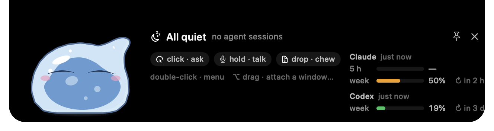

# Mochlet

A small anime slime that lives in your MacBook notch, watches your coding agents, remembers
what you drop on it, and listens when you hold it.

macOS 26 · Swift 6 · SwiftPM · local-first · one person, one slime



## What it is

Mochlet is a native macOS app that turns the notch into a tiny island with a character in it.
The character is a soft-body slime drawn in the style of a Japanese TV anime: a translucent bun
of jelly with a pale shell, a darker core, one hard highlight and a thin ink line. It breathes,
blinks, looks at your pointer, wobbles when it lands and dents where you poke it.

Everything you do starts from the slime. Click it to ask something, hold it to talk, drop a file
on it to file the file, drag it out of the notch to keep it on your desk. When a coding agent
runs in a terminal, a mini slime pinches off and reports on that session until it ends.

## What it does for you

- **Watches your coding agents.** Claude Code, Codex, Gemini CLI and a few more send their hook
  events to Mochlet. Each session becomes a mini slime with a one-line ticker. Permission
  requests, plan approvals and AskUserQuestion prompts become cards you answer from the notch.
  `⌃⌥T` jumps to the exact terminal tab or tmux pane. Plan-usage pills show how much of your
  Claude and Codex plan is used.
- **Keeps a knowledge base you own.** Drop a PDF, a slide deck, a link, an image, a recording or
  a paragraph of text on it. Mochlet reads it in full, writes a report page, files it under a
  project and updates the entity and concept pages it touches. Everything lands in
  `~/Mochlet/Knowledge/` as plain Markdown you can open in Obsidian. Ask it a question and the
  answer streams back with citations. Your agents reach the same pages over MCP.
- **Listens.** Hold the slime or press `⌃⌥V`, say what you want, let go. Speech is transcribed on
  this Mac with Apple's `SpeechAnalyzer`. Clear phrasings are routed by rules: a note to self, a
  task for a project, a link to save, a question for the knowledge base. The rest goes to chat.
- **Takes meeting notes.** Triple-click in a call. It captures your microphone and the system
  audio, transcribes both sides on this Mac, tells speakers apart, and writes a transcript and a
  summary with decisions, action items and timestamps. It notices calls on its own and asks
  before capturing.
- **Follows AI news.** A local pipeline fetches feeds, filters and scores items against a rubric,
  groups them into events and ranks them by heat. A daily digest lands in the knowledge base.
- **Chats and runs tasks.** Type anything into the ask bubble. Chat goes to Claude Code, Codex or
  Gemini on your subscription, or to an API provider with a key kept in your Keychain. "Work on
  mochlet: fix the build" opens a terminal in that project with the agent already on the task.

## Meet the slime

| Gesture | What happens |
|---|---|
| hover | it looks at the pointer and the island grows a little |
| click | the ask bubble, with suggestions |
| double-click | the quick menu: sessions, projects, knowledge, signals, meetings, settings |
| triple-click | meeting note-taker on or off |
| five clicks | it splits into droplets and pulls itself back together |
| hold, or `⌃⌥V` | push-to-talk |
| drag | take it out of the notch to any corner or edge of any screen |
| ⌥ drag onto a window | attach that window as context for the next message |
| drop a file, folder, link or text | it chews it into the knowledge base |

The slime is yours to shape. Fifteen looks change the body itself (cat and fox with jiggling
ears, tempest and bat with wings, horns, a ghost, a flame, a crystal). Twelve colours or a hue
of your own. Outfit sets and single pieces, with round glasses while it reads and a nightcap
while it sleeps. Two sound packs: squishy puni foley with tiny voice squeaks, or the classic
chimes. The round-eyed face from earlier versions is still there under Settings → Character → Face.

It has hands and moods. A dropped file is caught, hugged, bitten and filed with a gulp. It waves
hello, gives a thumbs up to an approval, cheers a hot signal, facepalms an error, melts when the
Mac runs hot and puffs up when you deny it something. The style guide the renderer is tuned
against is [docs/CHARACTER.md](docs/CHARACTER.md).

## Install

Mochlet needs macOS 26. It is designed for the notch, and the slime can also live loose on the
desktop. There is no signed download yet, so build it from source with the Swift 6 toolchain
that ships with Xcode 26:

```sh
git clone git@github.com:Ilexpwh/Mochlet.git
cd Mochlet
scripts/build-app.sh release      # → build/release/Mochlet.app
open build/release/Mochlet.app
```

No Xcode project is needed. SwiftPM builds the app, the three helpers and the resource bundles,
and the script assembles the bundle and signs it ad hoc. `scripts/release.sh` is the signed and
notarised path once you have a Developer ID.

### First five minutes

1. Launch it. The slime drops into the notch, greets you and settles.
2. Settings → Agents → Install for the agents you use. Mochlet shows the whole settings file
   before it writes anything and keeps a dated backup next to it.
3. Run `claude` in a terminal. A mini slime appears for the session; ask Claude to run a shell
   command and the approval card shows up in the notch.
4. Drop a PDF on the slime. Watch it chew, then open `~/Mochlet/Knowledge/inbox/`.
5. Hold the slime and say "note to self: try Mochlet for a week". The note lands in
   `Knowledge/notes/` under today's date.
6. Give your agents the same knowledge:

```sh
claude mcp add mochlet -- "$HOME/Library/Application Support/Mochlet/bin/mochlet-mcp"
```

## Privacy

Mochlet is built to keep your data on your Mac. Speech recognition, meeting transcription,
speaker separation, document extraction and search embeddings run on device with Apple
frameworks. The knowledge base, meeting notes, projects and signal sources are plain files
under `~/Mochlet`. API keys live in the Keychain, never in logs or defaults.

The parts that need a language model (report pages, knowledge answers, signal scoring, chat)
go to the provider you choose: your Claude Code, Codex or Gemini subscription, an API key you
add, or a local Ollama or LM Studio server. Links handed to Mochlet by an agent or a feed may
only reach public hosts. Each macOS permission is requested by the feature that first needs it,
and Settings → General lists where every one of them stands.

## How it works

```
 coding agents (Claude Code, Codex, Gemini, …)        your files, links, voice, meetings, feeds
        │ hooks (stdin JSON)                                   │
        ▼                                                      ▼
  mochlet-hook (relay)  ──one JSON line──▶  ~/Library/Application Support/Mochlet/mochlet.sock
                                                               │
  Mochlet.app: AppCoordinator wires stores and controllers; NotchWindowController owns the panel;
  SlimeBridge is the only caller of SlimeKit (main slime, one mini per session, droplets, ghost)
        │ files                                              │ loopback HTTP: MCP + ingest endpoint
        ▼                                                    ▼
  ~/Mochlet/{Knowledge, Meetings, Projects, signals/}        mochlet-mcp (stdio shim)
```

Three SwiftPM packages, each with its own tests:

- **SlimeKit** is the character. The body is a ring of 24 Verlet points with anchor, edge, bend
  and pressure forces, stepped at 1/240 s with volume kept by construction. Arms are pseudopods
  published as goo blobs and merged into the silhouette by metaballs. The face is strokes
  projected onto a sphere. Every state and emote is a table, every motion is seeded and
  time-injected, so filmstrips and tests are reproducible. `SlimeKitUI` renders one `SlimeFrame`
  with CoreGraphics in layers (two-tone cel body, brush-stroke face, outfits, props, glyphs) and
  redraws only the frames that differ. `slimekit-tools` renders filmstrips and catalogs, runs
  the benchmark, opens a live Emote Lab and draws the app icon.
- **MochletCore** is pure logic with no AppKit: the notch state machine, hook normalisation and
  the session reducer, the approval queue, the diff engine, project intents, the OKF
  reader and writer, the knowledge index (SQLite FTS5 plus on-device
  embeddings), voice intent rules, meeting models and the signals pipeline. Reducers return
  effects; tests drive them with an injected clock. `MochletServices` wraps the Apple
  frameworks headlessly: speech, Core Audio taps, extractors, embeddings, the loopback server.
- **App** is a thin shell: the panel over the notch, the SwiftUI island, gestures, drag-out,
  settings and the `mochlet://debug/…` channel that lets a debug build be driven and
  photographed from a terminal.

The full tour is [docs/ARCHITECTURE.md](docs/ARCHITECTURE.md). Hook formats per agent are in
[docs/AGENTS.md](docs/AGENTS.md), the knowledge bundle in [docs/KNOWLEDGE.md](docs/KNOWLEDGE.md),
and the manual pass before a release in [docs/VERIFY.md](docs/VERIFY.md).

## Status

Version 2.1.2. The 2.x line is a rewrite from scratch in native Swift; the first implementation
is kept under the git tag `v1-final`. The character has just been through its third pass
(the anime look: bun silhouette, two-layer material, stroke face, anime timing), and it is still
being tuned by eye against the reference stills.

What is next, roughly in order: publish signed builds, give the knowledge base its
`memories/` section, and keep polishing the slime. Nothing here is a promise; this is one
person's project and it moves at the pace of evenings.

## Why I built this

I wanted the thing on my screen that watches my agents to feel alive, not like another panel of
status text. A character you poke, feed and talk to makes a Mac feel like company. Everything
else in Mochlet grew out of that: if the slime is going to eat my files, it should remember them;
if it is going to listen, it should do something with what it hears.

## Developing

```sh
scripts/build-app.sh debug        # → build/debug/Mochlet.app
scripts/dev-run.sh                # build debug and launch (kills a running copy first)
scripts/test.sh                   # SlimeKit, MochletCore and app tests, then the relay check

cd Packages/SlimeKit
swift run slimekit-tools render-filmstrip --state greeting --out ../../out/greeting
swift run slimekit-tools render-catalog --radius 56 --out ../../out/catalog.png
swift run slimekit-tools lab              # live Emote Lab with sliders and every state
swift run -c release slimekit-tools bench # engine and draw cost per frame
```

Debug builds answer `mochlet://debug/…` URLs with a per-launch token, so the island can be posed,
poked and photographed from a script without screen-recording permission. The command list is
in [docs/VERIFY.md](docs/VERIFY.md). `scripts/replay-hooks.sh` plays recorded agent sessions
through the real relay and socket, and `scripts/smoke-ingest.sh` exercises the knowledge engine
without the app.

## Contributing and feedback

This is a personal project, built in the open. Issues with a screenshot or a filmstrip are the
most useful thing you can send, especially anything about how the slime looks or moves. Small
fixes as pull requests are welcome. Larger changes are best discussed in an issue first, since
the character and the feel of the thing are the point.

## Licence

No licence has been chosen yet. Until one is added, the source is here to read and build for
yourself, not to redistribute.

## Credits

The slime is fan art after Rimuru Tempest from *That Time I Got Reincarnated as a Slime*, drawn
to the standard of the anime, the sticker sheets and the Bandai figures. Mochlet is not
affiliated with or endorsed by the rights holders. The knowledge base follows the
[OKF](https://okf.md) bundle format and the "LLM wiki" idea; the signals pipeline reads AIHOT's
source files. Speech, audio, extraction and embeddings use Apple frameworks.
