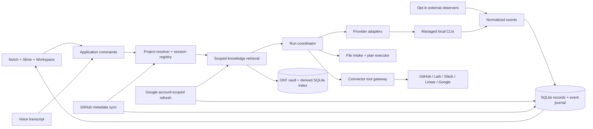

# Architecture proposal

## Boundaries



## Technology decisions

| Decision | Proposed choice | Reason / qualification |
|---|---|---|
| Native UI | SwiftUI with AppKit window/panel management | Native window behavior, notch positioning and drag/drop |
| Process coordination | Swift concurrency and a typed process/transport layer | Keeps CLI ownership outside views |
| Persistence | SQLite behind a repository interface | Durable task history, migrations and transactional journal updates; choose a maintained wrapper during implementation |
| Knowledge | OKF documents + derived SQLite FTS index | Portable authoritative knowledge with bounded scoped retrieval; embeddings optional after evaluation |
| Secrets | Keychain for app-owned credentials | Keep connector credentials separate from logs and prompts |
| Codex | Structured app-server adapter | Control protocol rather than parsing decorative terminal output |
| Pi | Version-pinned 1.4.0 RPC adapter | Separate wire protocol, verified session/cwd handshake and original approval extension; see pi-compatibility.md |
| Claude | Version-pinned 2.1.296 control-protocol adapter | Dedicated event/permission translation; stronger pre-dispatch cwd verification remains open |
| Speech | Swappable transcription interface | Benchmark local options against target hardware/languages; no engine selected yet |
| Packaging | Local development build, then signed/notarized direct distribution | App Store/sandbox feasibility remains a separate study because the product launches user-installed CLIs |

No third-party package versions are pinned by this plan. Check current official documentation, maintenance and licensing when adding each dependency.

## Proposed source layout

This tree is a future structure, not files that already exist. Start with one Xcode app target and a testable Swift package for the core. Split additional packages only when dependency boundaries justify it.

```text
slime-app/
  SlimeApp.xcodeproj/              # created in T02
  App/
    SlimeApp.swift
    CompositionRoot.swift
    Surfaces/                     # notch, workspace, settings
    Character/                    # rendering + expressive state
    Voice/
  Packages/SlimeCore/
    Package.swift
    Sources/SlimeCore/
      Domain/
      Persistence/
      Runtime/
      Projects/                   # registry, routing, session/workspace bindings
      Knowledge/                  # OKF vault, derived index, evidence packets
      Providers/Codex/
      Providers/Claude/
      Providers/Pi/
      Files/
      Connectors/
    Tests/SlimeCoreTests/
    Tests/Fixtures/
  Bridges/                        # only if a provider needs a helper
  scripts/                        # reproducible build/test checks
  docs/
  tasks/
```

## Domain model

| Entity | Essential fields / relationships |
|---|---|
| SlimeProfile | ID, name, appearance, instructions, voice preferences, default runtime-config ID |
| RuntimeConfig | Provider ID, executable, model, configuration references, capability manifest, tested version |
| Project | ID, title, aliases, verified roots, instructions, knowledge scope, repository and board bindings |
| SessionBinding | Project/task/provider/account IDs, exact thread ID, checkout/worktree, effective cwd and last activity |
| KnowledgeConcept + MemoryRevision | Portable document path and stable app ID, scope, source revision/hash, lifecycle and provenance |
| GitHubMirror + DispatchClaim | Stable remote object IDs, cursors/revisions, local-task links and active-work deduplication |
| Task | ID, project, title, description, desired outcome, status, priority, labels, assigned profile, parent/dependency references |
| Run | ID, task, attempt, runtime-config snapshot, provider/session/turn IDs, lifecycle, timestamps, outcome |
| PendingInput | Run/session/turn/request IDs, approval/question type, options, payload, deadline, delivery state |
| Artifact | Run, local location, media type, source references, provenance |
| UsageSnapshot | Provider/account key, measurement kind, bucket, unit, value, window/reset, source, timestamp, known/stale state |
| FileManifest | Selection/root, items, hashes, size, type, extraction/skipped/failure state |
| FilePlan + Operation | Run, allowed roots, source/destination, preconditions, authorization, operation/result journal |
| Connection + ExternalLink | Service/account metadata, Keychain reference, granted actions, stable remote IDs and revisions |
| GoogleResourceBinding + SyncState | Connection/service/collection/object IDs, project scope, selection/filter, revision, per-collection cursor, freshness and permission state |

Account snapshots must be deduplicated by provider/account/bucket. Per-run token counts and account quotas are different records. Deleting a runtime configuration must not erase historical runs.

## Adapter contract

Conceptual commands: `probe`, `start`, `resume`, `sendInput`, `answer`, `cancel`, `subscribe`. Optional commands remain explicitly unsupported until implemented.

Capabilities include structured events, resume, cancel, steering, tool approval, user questions, images, account limits and external observation/control. Capabilities are version- and authentication-dependent; an adapter name alone is insufficient.

Normalized events include run start, text delta, tool activity, pending approval, pending question, usage update, artifact discovery, completion, failure and connection loss. Each event includes run/provider identity plus available provider session, turn, request and event IDs.

Persist meaningful transitions before publishing them to the UI. Aggregate text deltas for bounded storage/rendering. Retain enough raw protocol diagnostics to debug failures, with secrets redacted and retention controls.

Spawn executable paths with argument arrays. Frame structured stdout independently from stderr. Use bounded queues, line/frame limits and backpressure. Never interpolate user input into a shell command string.

## Ownership and lifecycle

**M1:** the menu-bar app owns processes; closing the notch/workspace leaves it alive. One active run with a queue avoids accidental concurrent writes. A later scheduler may permit independent projects concurrently and must serialize conflicting roots.

**Quit:** active work is shown before deliberate termination; supported detachment may be offered only when the provider guarantees it. Do not promise background survival after quit.

**Relaunch:** reconcile durable run records with owned process/session evidence. Resume only through a supported provider mechanism. If the outcome is uncertain, mark interrupted and ask for a deliberate retry; never infer success or restart automatically.

**Observed session:** use supported, opt-in hooks/event feeds. Preserve the user's existing configuration. Activity observation is separate from control. Opening its owning terminal is a valid fallback.

## File analysis versus execution

The intake pipeline enumerates only the chosen roots, respects traversal limits, validates formats, records skipped files and generates model-ready derivatives. Large files are chunked with stable source references. Persist what was processed so partial analysis stays visible.

For organization, the agent outputs a schema-validated plan. The executor performs path/collision/hash checks and journals each operation. Safe preview mode requires read-only agent tool access for that run; if the provider cannot enforce it, offer analysis/plan generation without advertising a guaranteed no-write agent sandbox. Application-level UI restrictions alone cannot contain a CLI with broad filesystem permissions.

Same-volume rename and cross-volume move have different execution/recovery paths. Cross-volume moves use copy → verify → remove. Undo is conditional on unchanged postconditions. File executor history does not undo arbitrary shell commands or connector side effects.

## Attention and trust

Pending requests bind to the exact run and provider request. Deliver responses once; show delivery errors. Invalidate items on provider resolution, timeout, completion or lost control channel. Remote conversations and ingested files supply context, not elevated authority.

Approved connection tools are scoped to account/project/run. File content may leave the Mac through the selected CLI/model even when the orchestration is local. Credentials never become generic prompt context.

## Reference material

- [Existing visual blueprint](reference/blueprint.html) and [Coucou system map](reference/coucou-system-map.html).
- [Codex app-server](https://learn.chatgpt.com/docs/app-server), [Claude headless](https://code.claude.com/docs/en/headless), [Claude SDK](https://code.claude.com/docs/en/agent-sdk/overview), [Claude status line](https://code.claude.com/docs/en/statusline), [Pi RPC](https://github.com/earendil-works/pi/blob/main/packages/coding-agent/docs/rpc.md).
- Local Multica study: project, issue and agent types; daemon task model; provider Backend interface. Exact file references and study scope are recorded in the HTML blueprint.

Provider research was performed on 2026-11-01. Recheck protocols against installed versions during each implementation spike. This plan does not claim that all advertised upstream capabilities are installed locally.


## Expanded core contracts

- [Project routing](project-routing.md) resolves a stable destination before retrieval or dispatch and validates the provider-returned cwd. A project may have many task-specific sessions; selection is never “latest session globally.”
- [Knowledge/memory](knowledge-memory.md) keeps personal and project scopes separate, adds citation/freshness/conflict handling, and makes the local search index rebuildable from portable documents.
- [GitHub integration](github-integration.md) separates work-metadata sync, source-code checkout operations and knowledge refresh. It owns cursors and write reconciliation independently of agent tools.
- [Google integration](google-integration.md) adds account-isolated Gmail/Calendar/Drive adapters, selected document evidence and authorized outbound actions. App-owned refresh, temporary caches and durable memory remain separate.
- [Native quality](native-quality.md) owns animation, input responsiveness, display/focus behavior and service-lifetime/resource budgets from the first milestone.

This revision retains the native Swift architecture and does not introduce a mandatory OpenViking server, remote memory database or always-on cloud relay.

## Google source implementation — 2026-11-01

AppAuth 3.0.0 handles desktop PKCE/loopback OAuth and refresh; Keychain stores per-account authorization state. `GoogleReader` performs bounded account-verified Gmail, Calendar and Drive reads through an ephemeral no-redirect transport. `Connections` persists account generations, source identities and project grants separately from tasks. `GoogleController` orchestrates native selection and explicit analysis/memory/task capture. Source drafts retain structured provenance through Send, with local and remote access checks before dispatch. See [Google implementation and limits](google-integration.md). Outbound delivery and incremental sync remain separate work.
