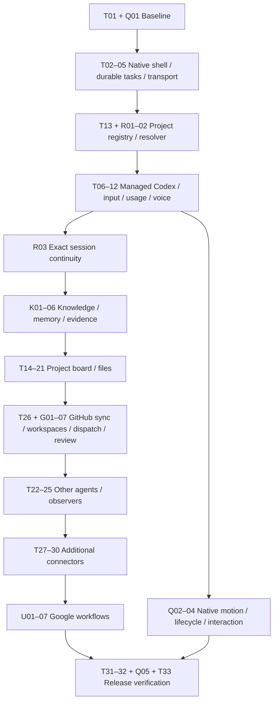

# Implementation plan: Mochlet

Status: implementation in progress, created 2026-11-01. Implemented slices and verification limits are recorded in docs/build-status.md. Revised 2026-11-01 for required knowledge/memory, project-aware Codex sessions, GitHub synchronization, native quality and Google integrations. Task completion is tracked only in [todo.md](todo.md). Existing task IDs are preserved; execution follows dependencies and the release order below.

## Outcome

Build a native Mac notch companion with customizable slime characters that execute work through selected local AI CLIs. Persist tasks and projects independently of provider sessions. Add voice, safe file workflows and connected work tools in verifiable releases.

The new app lives in `/Users/ilexpoon/Mac-notch-ai-project/slime-app`. Reference projects remain outside its implementation tree. See [product scope](../docs/product.md), [architecture](../docs/architecture.md) and [suggestions](../docs/suggestions.md).

## Decisions and assumptions

1. **New native implementation.** SwiftUI/AppKit shell; original character assets. Study Coucou behavior without coupling the new app to its global state.
2. **Personal Mac first.** Local persistence and local runtime ownership; no team identity or cloud server in M1.
3. **Codex first.** Prove one complete managed runtime before generalizing to Claude/Pi. Each adapter declares actual capabilities.
4. **Task/run/session separation.** Retries and provider changes preserve task history while recording separate attempts.
5. **One active run initially.** Queue additional tasks. Add cross-project concurrency after shared-root ownership is defined.
6. **Voice is an input layer.** A visible transcript enters the same task path as typed input. The speech engine remains an early feasibility decision.
7. **Files use a separate executor.** The agent proposes operations; validated, authorized execution and recovery are application responsibilities.
8. **No automatic connector writes.** Support scoped actions and explicit authorization, including pre-authorized specific workflows when later configured.
9. **Version support is tested.** CLI protocols and account telemetry vary. Do not promise compatibility based only on a provider name.
10. **Provisional support target:** Apple Silicon, macOS 15+, direct local development. Confirm hardware/OS/distribution choices in T01.
11. **Knowledge is required core.** Portable OKF vault plus derived SQLite retrieval; explicit personal/project scopes, provenance, corrections and evaluation.
12. **Resolve before executing.** Project aliases and repository bindings determine cwd and task-specific Codex thread selection.
13. **GitHub is the first coding connector.** Repository metadata, Projects v2 items, local code operations and knowledge refresh remain separate.
14. **Native quality starts early.** Q01–Q05 establish original motion, responsive input, reliable lifecycle and measured budgets; the HTML demo is not the release bar.
15. **Working brand: Mochlet.** Keep the development folder name stable; public-name availability remains to be checked.
16. **Google is required connector scope.** Multiple accounts, Gmail, Calendar and selected Drive/Docs/Sheets/Slides sources; bounded retrieval and explicit project bindings reuse the existing runtime and memory contracts.

## Release sequence

| Milestone | Execution order / tasks | Deliverable and exit condition |
|---|---|---|
| M0: feasibility and design | T01, Q01 | Version/target evidence, native interaction/motion and measurement baseline |
| M1a: routed native companion | T02–T05; T13; R01–R02; T06–T12; R03; Q02–Q04 | Voice/text → correct project/session → human input → persisted result, with native lifecycle/motion evidence |
| M1b: knowledge and memory | K01–K06 | Portable scoped knowledge, editable memory, cited answers, explicit uncertainty and a passing initial evidence/isolation corpus |
| M2: projects and files | T14–T21 | Project board, file intake and cited summaries; reviewed file execution/recovery |
| M2g: GitHub-driven work | T26; G01–G07 | Repository/issues/Projects sync → verified workspace → exact Codex task → review/authorized write-back |
| M3: multiple agents | T22–T25 | Claude/Pi and opt-in observers with honest capabilities and isolated input routing |
| M4: additional connectors | T27–T30 | Initial Slack/Lark/Linear capture and authorized delivery, reusing the connector ledger |
| M4g: Google workflows | U01–U07 | Account selection → mail/agenda/document context → correct project task → authorized replies/event changes, with recovery and isolation evidence |
| M5: release readiness | T31–T32; Q05; T33 | Accessibility, robustness and measured native quality on the packaged build |

Knowledge/memory, GitHub, Google integrations and native quality are required scope. T13 (project context) and T26 (connector foundation) are deliberately pulled forward. The 33 existing task IDs remain unchanged; R/K/G/Q/U tasks extend them. Numeric task order alone is no longer the execution order. Optional recipes, advanced cosmetics, cloud teams and unbounded autonomous issue processing remain outside these milestones.

## Dependency map

The release table defines the default delivery order. Independent work may be reordered only when its explicit prerequisites are satisfied. No separate agent/thread delegation is required by this plan.

## First implementation session

1. Confirm the provisional macOS target and inspect installed toolchain/CLI versions without invoking a model; record Q01 native design and profiling conditions.
2. Record the initial Codex protocol surface and authentication-dependent limits; select representative recorded fixtures.
3. Create the app target and testable core package. Provide a menu-bar item and an empty notch panel that opens and closes reliably.
4. Establish reproducible build/test scripts in that session. Later tasks refer to those scripts instead of guessing Xcode destinations or schemes now.
5. End with a runnable shell and documented verification, then build the original character, project registry and destination checks before the first real task.

Do not build the entire task-management database or every provider abstraction before the first complete Codex task can run.

## Verification policy

- Use targeted unit/fixture tests for state transitions, protocol framing, request routing, persistence and file operations.
- Use native UI/manual checks for display placement, focus, accessibility, speech permission and sleep/wake.
- Keep real-agent smoke tests distinct from fixtures. A live run may use account quota; use a user-authorized session and temporary test project, with no blanket re-confirmation if already authorized.
- Every 2–3 tasks has a checkpoint in the checklist. A checkpoint records evidence and material deviations; it is not an automatic permission prompt.
- Persist only meaningful completion evidence. A passing fixture test does not prove a live installed provider works.
- Use mock connectors and test files before any actual account write or personal-file operation.
- Do not mark the requested functionality complete when only its prototype or mock transport exists.

## Definition of done for a task

Its acceptance criteria are met; the focused checks pass; the native app still builds when applicable; failure/unsupported states are represented; and any supported-version or behavior changes are documented. For a milestone, demonstrate its user journey end to end, not merely individual components.

## Main risks

| Risk | Consequence | Planned mitigation |
|---|---|---|
| Provider protocol/version drift | Broken controls or missing events | Capability probes, pinned compatibility evidence and protocol fixtures |
| Claude authentication/distribution restrictions | Unsupported public integration path | Resolve in T22 before choosing a bridge; verify current official guidance |
| External session cannot be controlled | Misleading approval buttons | Managed/observed distinction and capability-dependent UI |
| UI process quits or sleeps | Lost work state or duplicate execution | Durable journal, reconciliation, explicit quit policy; helper later if justified |
| File plan races or cross-volume failure | Partial moves or data loss | Preconditions, collision handling, per-operation journal and conditional undo |
| CLI can write outside app file executor | False safety guarantee | Provider-enforced read-only tools for plan-only sessions or a clearly limited analysis path |
| Large folders/output streams | UI hangs, context overflow, excess cost | Bounded inventory, chunking, stream buffering and visible limits |
| Account quota missing or stale | Incorrect usage claims | Source/timestamp plus unknown/stale states; separate run consumption |
| Connector retries and edit conflicts | Duplicate messages or overwritten changes | Stable external IDs, idempotency ledger, revision/conflict checks |
| Native notch/full-screen behavior | Inaccessible or disruptive UI | Menu-bar fallback, display lifecycle tests and keyboard access |
| Reference-project license conditions | Unintended reuse obligations | Independent implementation; review license before any source reuse |
| Wrong project/session selection | Changes land in the wrong checkout | Registry IDs, exact thread binding, explicit ambiguity handling and returned-cwd validation |
| Stale/contradictory memory | Confident but unsupported answers | Source revisions, corrections, scope filters, abstention and evidence evaluation |
| Knowledge leakage between projects | Private context reaches an unrelated run | Pre-retrieval and pre-delivery scope checks, explicit shared scopes and forgetting tests |
| GitHub board spans repos or drafts | Incorrect issue dispatch | Distinguish board item identity from repository identity; require verified workspace mapping |
| Google account/scope confusion or consent restrictions | Wrong-account actions or unavailable features | Account-specific grants and project bindings, early OAuth/verification spike, partial-grant and revocation fixtures |
| Attractive but disruptive animation | Input delay, battery drain and poor accessibility | Q01–Q05 motion/lifecycle gates and native profiling from M1 |

## Decisions to settle before dependent work

These do not block the planning deliverable. Use the stated defaults until the corresponding implementation needs a final answer.

- Product name and exact character/art direction: proposed working name **Mochlet**, original soft slime, governed by [native quality](../docs/native-quality.md).
- Personal-only versus future public release: assume personal first; distribution/auth choices must support the intended audience before packaging.
- Minimum macOS and Intel support: provisional macOS 15+, Apple Silicon first.
- Voice languages and offline requirement: benchmark desired language support in T10; never claim offline behavior without confirming the chosen engine.
- Connector priority: GitHub first for the coding workflow; Slack, Lark, Linear and Google remain required later connectors; Google starts with Gmail/Calendar and selected Drive knowledge sources.
- File storage policy: preserve originals during analysis; default artifacts stay in the selected project output folder.

## Follow-on backlog

After M2: recipes and Finder quick action. After M3: explicit cross-provider handoff packets, configurable concurrent runs and usage-aware queueing. Later: audio/video/office extraction, advanced connector search, optional scheduled work, independent background helper, team sync and skin ecosystem. Knowledge/memory and GitHub diff/PR review have moved into required scope.

Before implementing one of these epics, split it into acceptance-driven tasks using the existing checklist format. See [recommended additions](../docs/suggestions.md) for prioritization.

## Expansion specifications and evidence

- [Knowledge/memory](../docs/knowledge-memory.md), [project routing](../docs/project-routing.md), [GitHub workflows](../docs/github-integration.md).
- [Google integrations](../docs/google-integration.md): Gmail, Calendar and selected Workspace knowledge sources.
- [Native quality and Mochlet identity](../docs/native-quality.md).
- [Acceptance scenarios](../docs/acceptance-scenarios.md) and [research notes](../docs/research-notes.md).

No reference project was copied, no memory service was installed and no GitHub account was connected in this planning revision.
